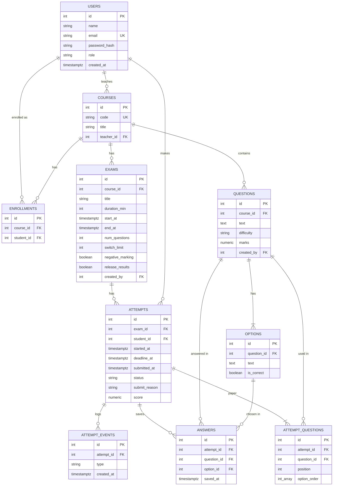

# DigiExam ER Diagram

## Relationships

| Relationship | Meaning |
|---|---|
| users to courses | A teacher teaches many courses. Each course has one teacher |
| users and courses via enrollments | Students and courses are many-to-many. Unique on (course_id, student_id) |
| courses to questions and exams | Both belong to exactly one course |
| questions to options | Each question has 2 to 6 options, exactly one correct (enforced in the API) |
| exams to attempts | One attempt per student per exam. Unique on (exam_id, student_id) |
| attempts to attempt_questions | Stores each student's own random paper and shuffled option order. Unique on (attempt_id, question_id) and (attempt_id, position) |
| attempts to answers | One saved answer per question per attempt. Unique on (attempt_id, question_id) |
| attempts to attempt_events | The audit trail: start, save, tab_switch, submit, auto_submit |

## Important constraints

- `users.role` is teacher, student or admin.
- `questions.difficulty` is easy, medium or hard, and marks must be above 0.
- `exams.end_at` must be after `start_at`.
- `attempts.status` is in_progress or submitted. `submit_reason` is manual, time_up or switch_limit.
- Deleting a course, exam or attempt cascades to its child rows. A question used in an attempt cannot be deleted (foreign key), and the API blocks editing it too.
- Indexes: attempts(exam_id, student_id), attempt_events(attempt_id), questions(course_id), options(question_id).